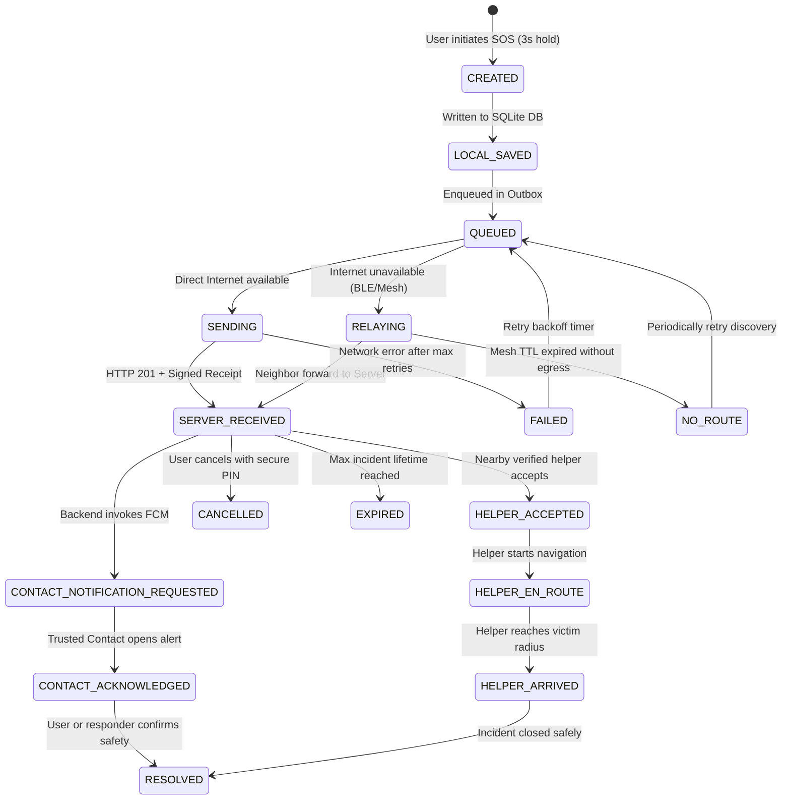

# GUARDVARX — System Architecture Document
**Safety. Connected. | The Human Emergency Network**

## 1. Architectural Philosophy & Constraints
GuardVarX is designed for mission-critical reliability under severe network constraints, high stress, and intermittent cellular connectivity. The system adheres to:
- **Offline-First Delivery:** Incidents are serialized and persisted to encrypted SQLite before any network I/O is attempted.
- **Explicit State Transitions:** No optimistic "delivered" or "rescued" flags. Every state change requires cryptographic or signed server receipts.
- **Modular Monolith Backend:** Go + Chi + PostgreSQL. Clean package isolation with domain-driven repositories and services. Avoids microservice sprawl while enabling easy scaling.
- **Battery-Conscious Native Layer:** Kotlin platform channels leverage Android's JobScheduler, Foreground Services, and BLE scanning filters with duty cycling to safeguard battery life.

---

## 2. High-Level System Architecture

```
                                  ┌─────────────────────────────┐
                                  │      Official Services      │
                                  │   (India 112 / SMS Gateway) │
                                  └──────────────▲──────────────┘
                                                 │ Fallback SMS / Dial
┌────────────────────────────────────────────────┴─────────────────────────────┐
│ MOBILE CLIENT (Flutter + Native Android Kotlin)                               │
│                                                                               │
│  ┌─────────────────────────────────────────────────────────────────────────┐  │
│  │ UI Layer (Material 3 Liquid Glass Design System)                        │  │
│  │ Screens: Splash, Onboarding, Auth, Home, SOS, SafeWalk, Contacts, Nearby│  │
│  └─────────────────────────────────────▲───────────────────────────────────┘  │
│                                        │ State Binding                        │
│  ┌─────────────────────────────────────▼───────────────────────────────────┐  │
│  │ State & Navigation (Riverpod 2.x + GoRouter 14.x)                       │  │
│  │ State Providers: Auth, Location, EmergencyState, SafeWalk, Sync        │  │
│  └───────────────────▲─────────────────────────────────▲───────────────────┘  │
│                      │                                 │                      │
│  ┌───────────────────▼──────────────┐   ┌──────────────▼───────────────────┐  │
│  │ Storage & Cache Layer            │   │ Networking & Sync Layer          │  │
│  │ - Drift (SQLite) Local DB        │   │ - Dio HTTP (TLS 1.3, Retries)    │  │
│  │ - Android Keystore Encrypted     │   │ - WebSocket Client (Auto-reconn) │  │
│  │   Secure Storage                 │   │ - Exponential Backoff Sync Queue │  │
│  └──────────────────────────────────┘   └──────────────▲───────────────────┘  │
│                                                        │                      │
│  ┌─────────────────────────────────────────────────────▼───────────────────┐  │
│  │ Native Platform Channel (guardvarx/connectivity)                        │  │
│  │ - BLE Peripheral (20-byte / 31-byte Advertising Packet)                 │  │
│  │ - BLE Central (Scan Filter with Duty Cycling)                           │  │
│  │ - Wi-Fi Direct / Aware Discovery Manager                                │  │
│  │ - Foreground Service for Safe Walk & Live SOS Monitoring                │  │
│  └─────────────────────────────────────────────────────────────────────────┘  │
└───────────────────────────────────────▲───────────────────────────────────────┘
                                        │ HTTPS / WSS
┌───────────────────────────────────────▼───────────────────────────────────────┐
│ GO BACKEND SERVER (Chi HTTP Router + pgx v5)                                  │
│                                                                               │
│  ┌─────────────────────────────────────────────────────────────────────────┐  │
│  │ HTTP Middleware Pipeline                                                │  │
│  │ - RequestID -> RealIP -> Logger (slog) -> Recoverer -> CORS -> Auth     │  │
│  │ - Rate Limiting (Token Bucket per IP / User)                            │  │
│  └─────────────────────────────────────▲───────────────────────────────────┘  │
│                                        │                                      │
│  ┌─────────────────────────────────────▼───────────────────────────────────┐  │
│  │ Core Domain Modules                                                     │  │
│  │ - Auth & Users Service (Firebase Token Verification & Profiles)         │  │
│  │ - Emergency Service (State Machine, Deduplication, Verification)       │  │
│  │ - Safe Walk Service (Session Monitoring, Heartbeat, Escalation)         │  │
│  │ - Contacts Service (Access Control & Consent Rules)                     │  │
│  │ - Responder Service (Proximity Matching & Mission Lifecycle)            │  │
│  │ - Community Service (Safety Reports, Rate Limits, Moderation)           │  │
│  │ - Real-Time WebSocket Hub (Topic-based Room Subscriptions)              │  │
│  │ - Notification Orchestrator (FCM push dispatch)                         │  │
│  └─────────────────────────────────────▲───────────────────────────────────┘  │
│                                        │ Parameterized Queries & Pool         │
│  ┌─────────────────────────────────────▼───────────────────────────────────┐  │
│  │ Storage & Persistence                                                   │  │
│  │ - PostgreSQL 16 (pgxpool)                                               │  │
│  │ - Versioned SQL Migrations (`migrations/`)                              │  │
│  │ - Audit Logging Engine (Non-repudiation & forensic tracking)            │  │
│  └─────────────────────────────────────────────────────────────────────────┘  │
└───────────────────────────────────────────────────────────────────────────────┘
```

---

## 3. SOS Delivery State Machine
The SOS delivery process is governed by a strict, unambiguous state machine:



### State Definitions:
1. `CREATED`: Triggered by intentional 3-second hold or hardware key combination.
2. `LOCAL_SAVED`: Persisted to local SQLite with cryptographic checksum.
3. `QUEUED`: Ready for transport dispatch.
4. `SENDING`: Active HTTPS POST request in progress.
5. `RELAYING`: Broadcasted over BLE / Wi-Fi Direct store-and-forward mesh.
6. `SERVER_RECEIVED`: Confirmed by Go backend; returns server timestamp and receipt ID.
7. `CONTACT_NOTIFICATION_REQUESTED`: FCM push payload dispatched to trusted contact tokens.
8. `CONTACT_ACKNOWLEDGED`: Contact opened notification and sent explicit acknowledgment.
9. `HELPER_ACCEPTED`: Nearby vetted volunteer or community responder accepted assignment.
10. `HELPER_EN_ROUTE`: Responder is traveling to the general incident zone.
11. `HELPER_ARRIVED`: Responder confirmed presence on site.
12. `RESOLVED`: Incident successfully concluded.
13. `CANCELLED`: Initiator confirmed false alarm or resolution using account PIN.
14. `EXPIRED`: Incident exceeded maximum active duration (e.g. 24 hours).
15. `FAILED`: Transmissions failed; awaiting network restoration.
16. `NO_ROUTE`: Offline mesh exhausted hop limits without finding an internet gateway.

---

## 4. Offline Mesh & Store-and-Forward Protocol

### 4.1. Compact Emergency Packet Structure (BLE Advertisement Payload)
To fit within standard Bluetooth Low Energy advertisement limits (and extended BLE advertising when supported), packets use a compact binary format:

| Field | Size | Description |
|---|---|---|
| `ProtocolVersion` | 1 byte | Protocol version (`0x01`) |
| `PacketType` | 1 byte | `0x01` SOS, `0x02` Relay, `0x03` Ack |
| `IncidentUUID` | 16 bytes | 128-bit RFC 4122 UUID |
| `Timestamp` | 4 bytes | Unix epoch in seconds (uint32) |
| `Latitude` | 4 bytes | 32-bit fixed point (degrees * 1e6) |
| `Longitude` | 4 bytes | 32-bit fixed point (degrees * 1e6) |
| `EmergencyType` | 1 byte | Enum: Personal Safety, Medical, Accident, etc. |
| `HopCount` | 1 byte | Current hop count (0 to 3) |
| `HopLimit` | 1 byte | Max allowed hops (default 3) |
| `Signature` | 16 bytes | HMAC-SHA256 truncated tag or sender auth token |

### 4.2. Relay Rules:
- **Duplicate Suppression:** Every device maintains an LRU cache of recently seen `IncidentUUID` hashes (capacity 1,000, 24-hour expiration).
- **Hop Limit Protection:** If `HopCount >= HopLimit`, the packet is dropped immediately.
- **Battery-Aware Relaying:** Devices with battery < 15% do not participate in active BLE advertising.
- **Ingress to Internet:** As soon as an intermediary device regains cellular/Wi-Fi connectivity, it delivers stored packets to `POST /api/v1/emergencies/relay`.

---

## 5. Safe Walk Journey Lifecycle

```
[User Starts Safe Walk]
       │
       ▼
Select Destination + Expected ETA + Check-in Interval (e.g. 10m) + Trusted Contact
       │
       ▼
[Active Journey] ──► Periodic Location Updates (Stored in ephemeral table, TTL 2h)
       │
       ├─► [User Check-in Prompt] ──(Acknowledged within 3m)──► Reset Interval
       │
       ├─► [Missed Check-in] ──(No response)──► Auto-Escalate to Warning State
       │                                              │
       │                                              ▼
       │                                  Push Alert to Trusted Contact
       │                                  with Last Known Coordinates
       │
       ▼
[Destination Reached / Safe Arrival] ──► Safe Walk Resolved & Ephemeral Tracks Pruned
```

---

## 6. Real-Time WebSocket Channel Architecture
- **Endpoint:** `/api/v1/ws`
- **Authentication:** Bearer token passed in initial connection handshake (`?token=` or Sec-WebSocket-Protocol).
- **Topics / Rooms:**
  - `user:{user_id}`: Private alerts, trusted contact updates, system notices.
  - `incident:{incident_id}`: Restricted to victim, assigned trusted contacts, and accepted helpers.
- **Message Types:**
  - `status_update`: Incident state change event.
  - `location_ping`: Safe Walk or active emergency coordinate stream.
  - `ack`: Message reception verification.
  - `heartbeat`: 30-second ping/pong to detect dead connections.
